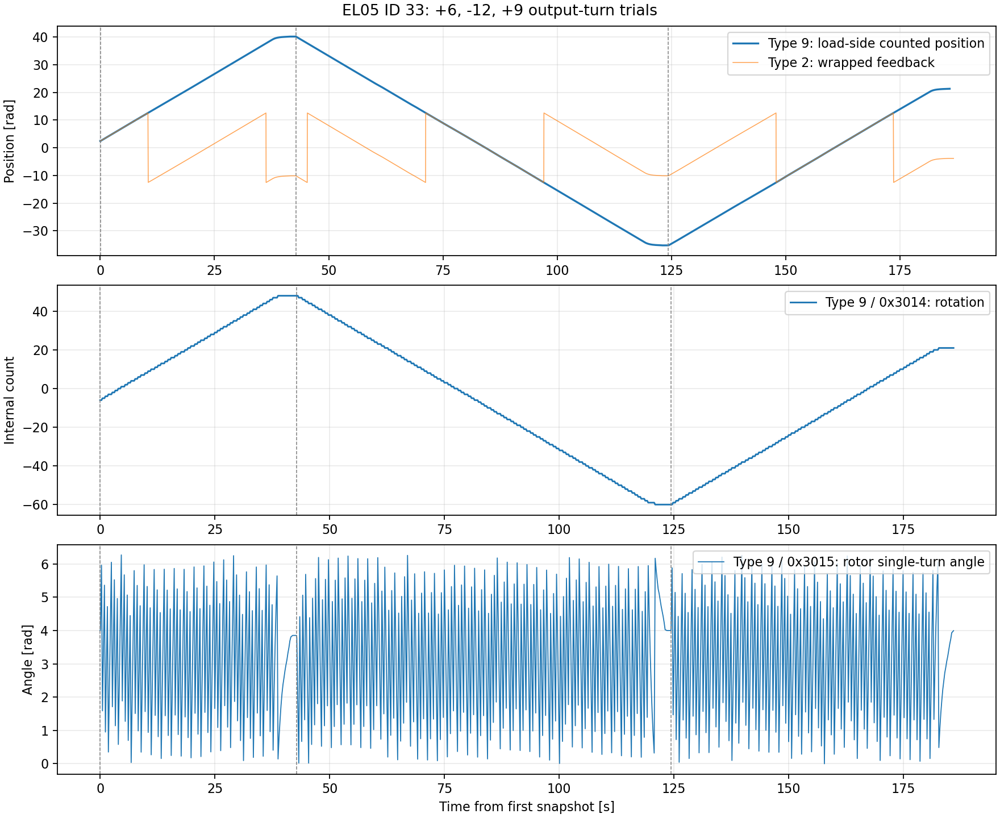

# EL05：多回転試験と170項目の電源再投入比較

調査日：2026-10-27。ブランチ：`feature/encoder`。実機ID 33、USB–CAN 921600 baud、ホストID 253。
この追加試験の回転・電源再投入の比較対象はID 33。ID 34について同じ結果を実測したという意味ではない。

## 結果

**Type 9で読めることは、不揮発保存されることを意味しない。**
実機の`rotation`は、出力軸を約+6、−12、+9回転させると+54、−108、+81変化した。
モーター側の回転数を数える値で、減速比9:1と一致する。
その後の電源再投入で`rotation`は21から−6に、`mechPos`は21.29217から2.44248 radに戻った。
今回も電源断前の多回転履歴の保持は観測されなかった。

別の回転数候補も含め、配布FW 4版の表の範囲を合わせた170コードを電源断前後で読んだ。
保持された設定値・故障履歴はある。しかし、今回の動作で増減し、その値を再投入後にも
保持した別の回転カウンターは、この範囲では見つからなかった。
未公開の別プロトコル、別FW、センサー内部の不揮発領域まで存在しないと断定した結果ではない。

## 回転試験

運動制御モード、Kp=0、Kd=1、目標速度最大1 rad/sで実施。
各区間後に停止し、Type 4の停止応答を確認した。
CAN watchdogは4000（約200 ms相当）を確認し、終了時も元の4000への復帰を確認した。
受信した故障フレームは0、報告温度の最大値は28 ℃だった。

| 区間 | 実測出力軸回転数 | `mechPos`変位 [rad] | `rotation`増分 | 終了時`rotation` |
|---|---:|---:|---:|---:|
| 正転6回転目標 | +5.997505 | +37.683435 | +54 | 48 |
| 逆転12回転目標 | −11.997411 | −75.381954 | −108 | −60 |
| 正転9回転目標 | +8.999919 | +56.548159 | +81 | 21 |



グラフのType 2角度は約25.13276 rad（約8π）周期で折り返した。
この折返しとType 9の連続角は別の現象。折り返すフィードバック値だけから
エンコーダーの保存能力や内部角度の上限を判断しない。
周期は今回の実測からの推定で、全機種・全FW共通の仕様値とはしていない。

停止時の測定では、おおむね以下が成り立った。

```text
motormechposition ≈ 2π × rotation + modPos − MechOffset
mechPos ≈ motormechposition / 9 + 2π
MechOffset = 0.8613302112 rad
```

後式の定数2πは今回の原点・初期化状態に依存する座標差で、普遍的な換算式ではない。
前式の停止時残差は最大約0.000024 radだったが、独立した角度基準器による精度検定ではない。
運動中は項目を順番に取得しているため、同時刻の値として残差を評価しない。

`0x3014`はType 9で型5（符号付き32 bit）、`0x701D`はType 17でその下位16 bitに一致した。
Type 17の`0x701D`も電源再投入で21から−6となった。
`0x7016 / loc_ref`と`0x7019 / mechPos`も、この停止状態ではともに
21.292166から2.442481 radへ変わった。残りの正常応答は生値も比較記録に収録している。
`0x304C / mech_angle_rotations`は累計約27回転の移動中も0、
`0x3044 / low_position`も0だった。一定値が再投入後も0であることを、回転履歴の保持とは扱わない。

## 電源再投入前後の全項目比較

軸を動かさずモーター電源だけをユーザーが再投入し、USB接続と読出しプロセスは維持した。
この比較の直前にはType 22を送っていない。
先行する別のType 22送信後試験については[保存処理調査](edulite05_retention_audit.ja.md)を参照。

| 読出し | 範囲 | 要求数／各時点 | 正常応答 | 拒否応答 | 応答欠落 |
|---|---|---:|---:|---:|---:|
| Type 9 設定 | 0x2000–0x2027 | 40 | 36 | 4 | 0 |
| Type 9 観測 | 0x3000–0x3052 | 83 | 79 | 4 | 0 |
| Type 17 | 0x7000–0x702E | 47 | 29 | 18 | 0 |
| 合計 | | 170 | 144 | 26 | 0 |

正常・拒否の内訳は再投入前後で同じ。Type 9の79正常応答には、後述の末尾ゼロ記述子を含む。
拒否を値0とは解釈していない。保存36項目の型に対応する有効値はすべて前後で一致した。
小さい型の値領域には余りバイトがあるため、その部分の一致を保持性判定に使わない。

位置・回転に関係する主な候補（名前は配布1.0.5.0.2の表に基づく）：

| Type 9コード | 名前 | 電源断前 | 再投入後 | 観測 |
|---|---|---:|---:|---|
| 0x3014 | rotation | 21 | −6 | 履歴は復元されない |
| 0x3015 | modPos | 3.995253 | 3.994102 | 単回転位相が近い |
| 0x3016 | mechPos | 21.292166 | 2.442481 | 約3出力回転分を失う |
| 0x3032, 0x3047 | position | 135.942154 | −33.705009 | 多回転値が変わる |
| 0x3033 | chasu_angle | 1.984588 | 1.984204 | 位相が近い |
| 0x3034 | as_angle | 3.992568 | 3.991418 | 位相が近い |
| 0x3035 | cs_angle | 5.977156 | 5.975622 | 位相が近い |
| 0x3036, 0x3049 | chasu_angle_out | 135.228073 | −34.421383 | 多回転値が変わる |
| 0x3037, 0x304A | motormechposition / motormechinit | 135.080826 | −34.566341 | 多回転値が変わる |
| 0x3044 | low_position | 0 | 0 | 回転中も一定 |
| 0x3045 | theta_mech_1 | −3.840576 | 2.442481 | 変化する |
| 0x3046 | instep | 0 | 0 | 今回の前後では一定 |
| 0x3048 | chasu_angle_init | 15.025341 | −3.824598 | 初期値も変わる |
| 0x304B | mech_angle_init2 | 15.008981 | −3.840705 | 初期値も変わる |
| 0x304C | mech_angle_rotations | 0 | 0 | 回転中も一定 |
| 0x304D | pos_cnt1 | 0 | 0 | 今回の前後では一定 |
| 0x304E | 配布表の末尾ゼロ記述子 | 168 | 168 | 以下の静的解析を参照 |

`fault3=6`、`fault6=6`、`fault7=2`等の故障履歴は保持された。
故障履歴用Flash領域が別にあることとも整合するが、これらを回転数として扱う根拠はない。
同じ位置で再起動すれば、再計測される単回転位相も近くなる。
「数値が近い／同じ」と「電源断前の多回転履歴を記憶している」は区別する。

### 0x304Eの168について

この項目は実機から正常ステータス・型0で`4e300000a8640020`と返った。
型0を使うと値は1 byteの168だが、値領域4 byte全体は`0x200064A8`となる。

配布1.0.5.0.2を調べると、観測表は`0x08014EAC`から12 byte刻み。
名前付き項目は0x3000–0x304Dの78個で、次の0x304E相当の記述子
`0x08015254`には名前ポインター・参照先・型がすべて0で置かれている。
一方、グループ3の個数表は79なので、Type 9の境界検査を通過する。
`0x0800AF38`で参照先0を取得し、`0x0800AF80`では型0の場合も参照先から
4 byteを読み出して返す。

**したがって、保持された168は、ゼロ参照先を通じてアドレス0の初期スタック値を
読んだ結果で説明できる。** `0x200064A8`はSRAM内のスタックアドレスとして整合する。
これは配布FWの静的解析に基づく推定で、実機のブートローダーとFW全体をダンプして
同一性まで確定したものではない。回転数保存の証拠には数えない。

## 保存経路の追加確認

通常設定保存以外も配布1.0.5.0.2で確認した。

| Flash領域 | 確認した書込み元・処理 | 回転履歴との関係 |
|---|---|---|
| 0x0807E000付近 | 通常設定表36項目 | rotation、mechPosは表にない |
| 0x0807D800、0x0807DC00 | RAM 0x20000330から128 word、別途ElecOffset・phaseOrder等 | 校正値の経路。現時点の多回転カウンターの保存を確認できない |
| 0x0807B000、0x0807B800 | 16 byteレコード2件、更新前の32 byteバックアップ | この経路に回転カウンターRAMからのコピーは見つからない。レコードの厳密な用途は未確定 |
| 0x0807A800 | RAM 0x2000090Cから10 word。fault1は0x20000910 | 故障履歴の配置と整合する |
| 0x0807D000 | 受信データから6 halfwordを書込み、B1/B2読出しで各6 byteを返す経路 | 工場データの可能性がある。用途は未確定。現在位置の自動スナップショット処理はこの経路に見つからない |

この表は全版の全Flash書込みを完全に分類したものではない。
とくに新しい版の追加領域やセンサーIC側の内部NVMは別途検証が必要。
書込み先を手当たり次第に変更したり、FWを交換したりはしていない。

## FWによるコードの違い

調べた配布版の名前付き観測項目数は順に77、78、80、83。
1.0.5.0.6では`rotation=0x3015`、`mechPos=0x3017`、
`MechPos_init=0x302F`、`mech_angle_rotations=0x3048`、`pos_cnt1=0x304A`となる。
今回の実機でこれらの新しいコードをその名前として解釈してはいけない。
全版の表を証拠JSONに収録した。

実機バージョン返答は`00 C4 56 0A 05 00 02 07`。
観測配置は配布1.0.5.0.2と整合するが、実機バイナリと配布ファイルの同一性は未検証。

## ソフト側の累積角度追跡の追加実装と検証

`feature/encoder`で、Type 2の折返しをつないで累積角度を保持する処理をdriverへ追加した。
モーター内部の不揮発保存とは別の、ノード実行中のメモリ上の処理である。
最初の位置は最初に受けたType 2の座標を使い、0にはしない。
復元・リセットの設定と適用条件は[日本語README](README.ja.md#電源再投入後の位置回転量の保持)を参照。

変更した`RobStrideDriver`本体を実機ID 33へ接続し、velocity command interfaceで
正逆各3回転を目標に、最大0.8 rad/sで動作させた。開始時のwatchdogが4000であることを
読み取り確認してから、driverも同じ4000を設定・確認した。終了後はStopした。
起動時のwatchdog設定読出しは1回再試行した後に成功した。

| 区間 | 累積位置の変位 [rad] | 実測回転数 | 停止時の内部角度との変位差 [rad] |
|---|---:|---:|---:|
| 正転 | +18.8314 | +2.99711 | +0.001777 |
| 逆転 | −18.8326 | −2.99730 | −0.000214 |

初期の累積位置は−3.85284 rad、Type 9内部位置は21.2788 radだった。
開始前からの整数回転数はノードには分からないため、この初期座標差を差し引いて変位を比較した。
正転後の累積位置は14.9786 radとなり、+4πを越えても負側へ折り返さず保持できた。
運動中の内部角度読出しとは時刻が異なるため、表は停止後に受信キューを処理して比較した結果。
最初の比較用プログラムでは参照読出しの受信キューに遅延があって比較に失敗し、
正転区間後に停止した。上表は参照受信を修正して完走した試験である。

driverとros2_controlのC++テスト96件、Xacroテスト40件はすべて成功した。
ROS topicを使う模擬モーター試験には、複数回の正逆折返し、予期しないReset後の復元、
復元後の位置指令の座標変換、reset設定での旧位置目標の拒否と再activate、
最初の返答がRunとなる通信断後の復元を含む。
**変更後driverのrestore/reset切替に対する物理的な電源再投入試験は、この追加試験では未実施。**
上記のモーター内部の保持性試験と、今回のソフト実装の検証範囲を区別する。

追加試験の[集計・ソースハッシュ](evidence/edulite05_runtime_tracking.json)と
[544件の測定イベント](evidence/edulite05_runtime_tracking.jsonl)を保存した。

## 実行中のROS関節原点設定の検証

各jointの`~/zero_position_<CAN ID>` Triggerサービスをdriverへ追加した。
原点変換をhardware interface側で統一し、上位からサービスを呼ぶ構成。
モーターの機械ゼロは変更せず、次のreadからROS側の関節角度を新しい原点で返す。
位置指令制限も座標変換し、同じ物理範囲を保つ。
対象関節のposition command interfaceが使用中の場合や、新しい位置feedbackがない場合は拒否する。
呼出し手順は[日本語README](README.ja.md#実行中の現在位置を関節原点にする)を参照。

実機ID 33をvelocity command interfaceで0.3 rad/sの低速回転中にサービスを呼び、確認した。

| 時点 | ROS関節角度 [rad] | モーター内部角度 [rad] |
|---|---:|---:|
| 呼出し前 | −3.585927 | 21.545742 |
| 成功後の最初の記録 | +0.006136 | 21.558140 |
| 続けて約1秒回転し、停止した後 | +0.300665 | 21.853006 |

原点はサービス実行時の最新測定位置であり、最初の記録時には回転により約0.00614 rad進んでいる。
関節角度を新しい原点から加算しつつ、モーター内部の位置は連続したままであることを確認した。
送信監視でType 6の機械ゼロ設定フレームは0件。
その後のposition interface使用中の原点設定は拒否され、最後にモーターをStopした。
watchdogは4000を確認して同じ値で使用。起動時の設定読出しは1回再試行後に成功した。

サービス・座標変換・位置制御中の拒否・古いfeedbackでの拒否・サービスの終了処理を含め、
driverとros2_controlのC++テスト101件はすべて成功した。
[実機確認の集計とソースハッシュ](evidence/edulite05_runtime_zero.json)、
[測定イベント](evidence/edulite05_runtime_zero.jsonl)を保存した。

## プログラム再立ち上げ時の位置保持確認

モーター電源を維持したまま新規プロセスを起動し、ROS側のソフト原点を設定してから、
現在位置の保持を開始する確認を行った。
**この実機試験では移動を検出して中止し、「再起動時に飛ばない」とは確認できなかった。**
送信前には目標とfeedbackの差が0.003 rad以内であることを検査したが、
保持開始後に観測した角度が開始値から0.03 radを超えて変化したため、試験プロセスを中止してStopした。
失敗した補助プログラムは開始角度や正確な最大変位を出力していないため、
この記録から正確な移動量は主張しない。予定していた2回目のプロセスとの比較は未実施。

その後、位置駆動せずにStop応答と内部値を採取した。
Stop応答はReset mode、fault flags=0だった。

| 項目 | 停止確認後の値 [rad] |
|---|---:|
| Type 9 / mechPos | 14.06758499 |
| Type 9 / theta_mech_1 | −11.06515694 |
| Type 2の位置（pkgの範囲でdecode） | −11.06227950 |
| mechPos − theta_mech_1 | 25.13274193（約8π） |

配布EL05 1.0.5.0.2の0x0800F628–0x0800F630では、位置PD項の誤差が
`cmdPos − mechPos`で計算される。`theta_mech_1`を引く処理ではない。
一方、起動直後のdriverが現在位置として使うType 2は折返し角度である。
**折返し角度を現在目標として送ることと、モーター内部の多回転位置で現在位置を保持することは、
この状態では同じではない。** 配布FWと実機全バイナリの同一性までは未検証だが、
この座標差とPD計算は、今回の移動の観測と整合する。
通常のfeedbackだけを仮定した模擬試験の成功を、この多回転状態での位置保持の保証には使わない。

ユーザーの指示に従い、同じhardwareの再activate時に旧指令を初期化するために試した変更は戻した。
本確認では製品コードの動作を変更しておらず、原点サービス実装時のソースハッシュと一致することを確認した。
また、ソフト原点はメモリ上だけのため、ノード再起動でROSの表示角度が変わり得る。
上位制御が旧座標の絶対位置目標を再送する場合も、別途移動の原因となる。

[確認結果と制限](evidence/edulite05_restart_check.json)、
[停止後の生フレームと内部値](evidence/edulite05_restart_readonly.jsonl)、
[位置PD処理の抜粋](evidence/edulite05_restart_position_excerpts.asm)を保存した。

## 記録と再確認方法

- [回転試験の集計](evidence/edulite05_extended_rotation.json)、[856点のCSV](evidence/edulite05_extended_rotation.csv)、[区間・停止・復帰イベント](evidence/edulite05_extended_rotation_events.jsonl)
- [170項目の前後比較と4版の観測表](evidence/edulite05_full_parameter_power_cycle.json)、[生フレームを含む取得記録](evidence/edulite05_full_parameter_power_cycle.jsonl)
- [末尾記述子の値と配布FWハッシュ](evidence/edulite05_terminal_descriptor.json)、[追加のFlash・Type 9逆アセンブル抜粋](evidence/edulite05_additional_flash_excerpts.asm)
- [読出し専用ツールの170要求・170応答確認](evidence/edulite05_inventory_probe_validation.jsonl)
- [公式公開コードと保存表の先行調査](edulite05_retention_audit.ja.md)

読出し専用の再採取：既存USB–CANブリッジを起動し、次を実行する。

```bash
ros2 run robstride_examples encoder_probe.py --ids 33 --all-el05 --once \
  --interval 0.1 --duration 30 > inventory.jsonl
```

このツールが送るのはType 9・17の読出しだけ。
末尾の`complete_response_pass`と`missing_requests`で、送信完了と応答完了を区別できる。
拒否応答のstatusも保存する。170項目は既知の配布表の範囲であり、全16 bit空間の総当たりではない。
